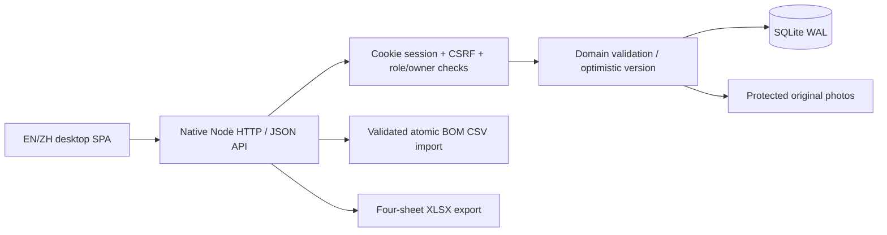
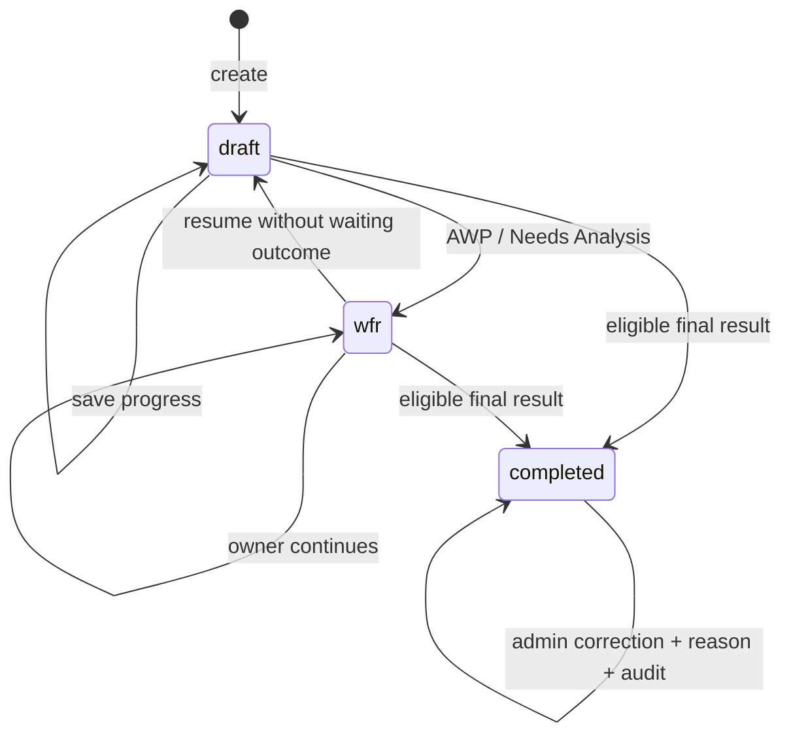

# V1 架构与数据模型

## 组件

无运行时 npm 依赖，Node 24 自带 HTTP、SQLite、密码散列和文件模块。前端原生 ES module，所有业务权限在服务端检查。Playwright 只用于开发自测。

## SQLite 表

| 表 | 职责 |
|---|---|
| meta | 演示／正式数据模式标记 |
| users | 独立账号、角色、启用状态、scrypt 密码哈希 |
| sessions | 会话 token 哈希、CSRF、过期时间，停用／改密失效 |
| models | 型号及双语功能清单 JSON |
| appearance | 双语外观选项 JSON |
| bom | 型号、SKU、描述、单位及启用状态，型号＋SKU 唯一 |
| records | 单次作业快照、检查／耗料／结果／归属及版本 JSON |
| photos | 作业关联、服务端文件名、图片元数据与移除标记 |
| audits | 修改前后完整业务快照、操作者、原因和时间 |

记录使用稳定作业 ID 与独立 Work Order；SN 非唯一。基础资料字典更新不会动态覆盖已保存快照。V1 小规模集中部署采用单进程 SQLite，查询会读取可访问记录后筛选；不宣称面向大型分布式或高并发仓储场景。

## 状态与互斥

outcome 为单个枚举，outcomeGroup 从其派生，不能三个分组分别提交结果。completed 不能通过普通保存解锁。保存用 version 乐观校验；检查、结果及耗用验证通过后事务提交，拒绝的修改不部分落库。

## 安全与文件

会话 HttpOnly/SameSite；JSON mutation 检查 CSRF 和来源；登录来源校验、防暴力尝试；用户字符串前端转义，XLSX 使用惰性文字单元格；图片内容校验且只允许 PNG/JPEG，原图不放 public；原文件名不用于物理路径。静态路径只在 public 内解析。日志不打印密码、会话或业务 payload。

图片移除保留原文件及审计标记，避免管理员更正破坏证据。API 权限同时覆盖记录、历史、图片和导出，不依赖前端隐藏按钮。

## 路由与页面

登录 → 我的／全部作业列表 → 同页编辑／详情。管理入口包含账号、型号／功能清单、外观字典和 BOM。历史、审计及 BOM 选择使用对话框／侧边宽抽屉，不拆成多步骤作业流。中英文切换使用同一份状态。

API 详细签名与错误见 API_CONTRACT.md。真实来源、需求边界和自主默认见 PRODUCT_CONTRACT.md，修复与验收见 DEVELOPMENT_LOG.md 和 TEST_REPORT.md。
