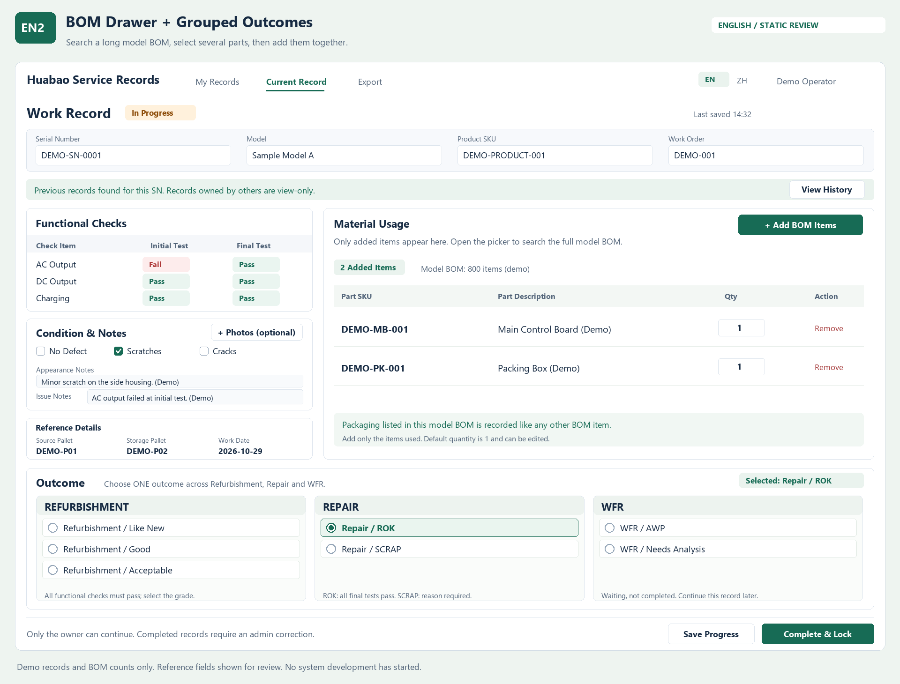
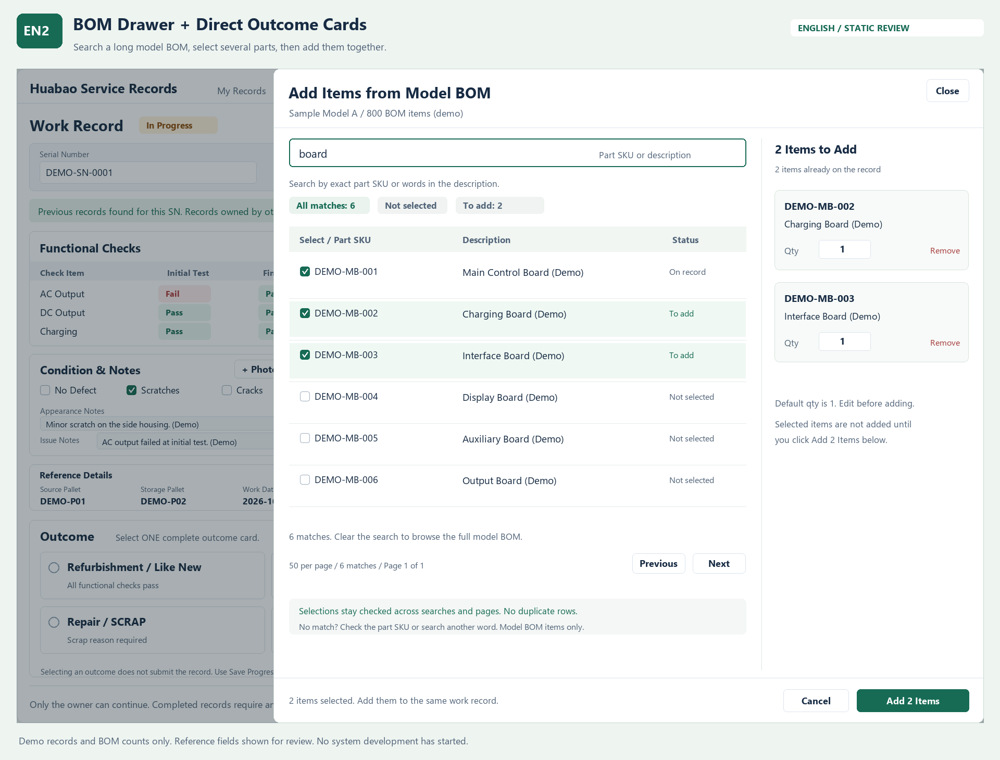

# EN2 同页作业：BOM 抽屉与分组结果 v0.4

日期：2026-10-29  
状态：按本轮用户意见生成的静态视觉修订稿，待整体视觉确认；未启动系统开发。

## 本次调整依据

用户倾向 EN2，明确要求作业结果按翻新、维修、WFR 分组，因此保留 EN2 的同页作业及 BOM 宽面板批量选料方式，将七张平铺结果卡调整为三栏分组。

本稿替代[英文视觉方案 v0.3](./英文界面与现表字段映射_方案v0.3.md)中 EN2 的平铺结果布局；其余已确认业务规则继续有效。旧版图片和文档保留，不覆盖。

## 界面规则

| 分组 | 直接可选的结果 |
|---|---|
| Refurbishment（翻新） | Like New、Good、Acceptable |
| Repair（维修） | ROK、SCRAP |
| WFR | AWP、Needs Analysis |

- 三栏同时显示，标题为说明，无需先选类别再展开下级菜单。
- 三栏中的所有选项属于同一组单选控件，合计只能选一个结果，不能每栏各选一项。
- 每个选项保留完整“类别 / 结果”标签，顶部明确显示当前选中项。
- 翻新仍需功能检查全部正常；ROK 仍需复测全部正常；SCRAP 必填报废原因。
- WFR 保持未完成，原作业员后续续填；选 WFR 时保存等待，不按已完成结案。
- 图中 ROK 为演示已选状态，实际新单不默认选择 ROK。

## 保留内容

- 英文作业界面、同页录入、检查及外观备注、图片选填。
- EN2 的 BOM 选料：在同页宽面板中按 Part SKU／描述搜索，多选并填写数量后批量加入。
- 主页面只显示本次耗用；重复 SKU 不新增重复行；数量默认 1、可修改。
- 账号权限、同 SN 他人历史只读、完成锁定及管理员更正规则。
- 现表整机 SKU 与栈板参考信息仍属于此前提出的字段映射建议，不因本次视觉调整自动成为新增已确认业务功能。

## 本版视觉

所有 SN、SKU、型号、检查项目、BOM 数量和记录内容均为示例。

BOM 选料面板沿用上一版英文设计：

本轮仅交付文档与静态视觉稿，不创建应用、接口、数据库或部署环境。整体方案确认后仍需用户明确发出开发指令。
