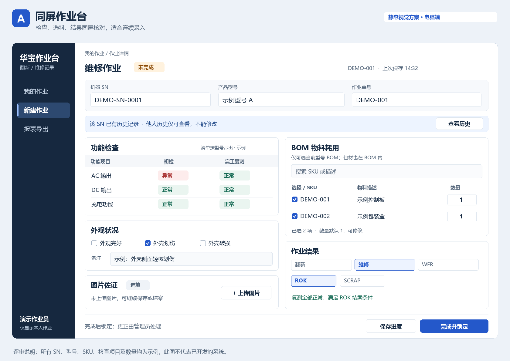
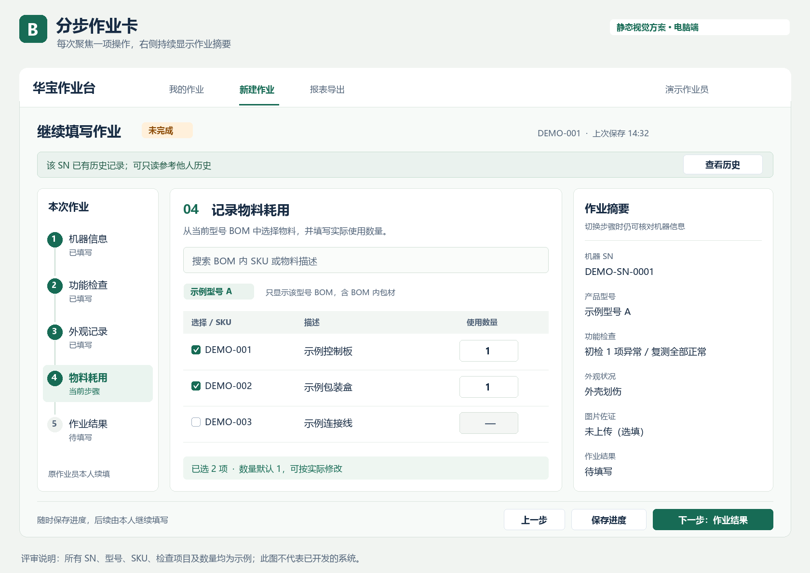

# 华宝翻新／维修记录系统——需求大纲与开发依据

版本：v0.1 评审稿  
日期：2026-10-29  
状态：核心业务规则已逐项访谈确认；整体文档及视觉方案待用户评审；尚未启动系统开发。

> 本文依据本次 18 个核心问题的访谈整理。标注“已确认”的内容来自用户决定；“建议默认”属于本次文档整理提出、待整体评审的规则；“待提供”是开发或上线前需要补齐的实际资料。静态视觉稿中的 SN、型号、SKU、检查项目及数据全部为演示，不代表真实业务资料。

## 1. 目标与成功标准

### 1.1 目标

现状由用户描述：华宝翻新／维修使用飞书表单记录，按型号选择物料并逐项记录耗用数量较困难。第一版建立一个电脑浏览器使用的网页系统，完整记录单台机器的检查、外观、物料耗用、图片佐证及作业结果，并可导出报表。

### 1.2 可验收的成功标准

1. 每次独立返修有独立作业单，同一 SN 的多次作业历史均可追溯。
2. 选择型号后带出对应功能清单和 BOM；每项耗用可追溯至 SKU、描述、数量和作业单。
3. 作业员可保存未完成记录，后续本人续填；WFR 可继续处理。
4. 实现本人数据隔离，同时支持输入同一 SN 时只读参考他人历史的明确例外。
5. 已完成记录锁定；管理员更正可追溯至更正原因、修改前后内容、操作人和时间。
6. 一个 Excel 文件完整导出作业、功能检查、物料耗用及图片索引；导出后可按作业单准确关联，不因一对多物料明细重复统计作业台数。

## 2. 使用者、范围与约束

### 2.1 使用者

- 作业员：录入、保存、续填本人记录，提交本人作业结果。
- 管理员：查看全部记录，必要时更正记录。
- 报表使用者：具体接收方尚未指定；第一版按已确认的完整明细导出要求设计，不预设客户结算模板。

### 2.2 第一版范围（已确认）

- 电脑端网页登录使用。
- 两类账号：作业员、管理员。
- SN 历史提示与查看、独立作业单管理。
- 型号、按型号配置的功能检查清单、预设外观缺陷及备注。
- 按型号 BOM 多选耗料，逐项填写数量，默认 1。
- 图片选填、多张上传。
- 翻新／维修／WFR 互斥结果及结案校验。
- 保存进度、本人续填、完成锁定、管理员更正。
- 四张工作表的 Excel 导出。

### 2.3 不在第一版范围

已确认排除：库存管理、库存自动扣减、通用耗材记录、作业员之间接续同一作业单。

建议默认排除，待整体评审：采购／入库／退料／盘点流程、物料价格与费用结算、ERP／WMS／飞书自动同步、历史飞书数据迁移、离线录入及同步、自动外观分级、客户审批流程、手机专用界面、自动 SN 识别型号。

### 2.4 约束

- 需求与视觉方案确认前不启动开发；本轮仅形成文档与静态设计稿。
- 飞书原表链接见第 14 节，本轮未成功读取，不能声称已核对其实际字段、字段类型和历史数据。
- 不把既有退货系统、库存系统或其他项目的要求自动并入本系统。
- 视觉方案批准不等同于已经授权实施；后续由用户明确发出开发指令。

## 3. 权限矩阵

| 操作 | 作业员 | 管理员 | 确认情况 |
|---|---|---|---|
| 日常记录列表 | 仅本人记录 | 全部记录 | 已确认 |
| 新建作业单 | 创建本人的独立作业单 | 是否兼任作业员不预设 | 作业员范围已确认 |
| 查看本人记录 | 可查看，包括已完成 | 可查看 | 已确认 |
| 续填未完成／WFR 记录 | 仅原作业员本人 | 可更正，不改变记录归属 | 已确认的权限原则 |
| 输入同一 SN 后查看他人历史 | 只读查看该 SN 的记录明细 | 可查看全部 | 已确认的特殊例外 |
| 修改他人记录 | 不允许 | 可更正，留原因及修改记录 | 已确认 |
| 修改已完成记录 | 不允许 | 可更正，留原因及修改记录 | 已确认 |
| 维护型号／功能清单／外观选项／BOM／账号 | 不允许 | 建议由管理员维护 | 建议默认 |
| 批量导出 | 建议仅导出本人记录 | 建议可导出全部或筛选结果 | 建议默认 |

重要边界：同 SN 只读例外不能变为任意浏览他人全部作业的入口。建议该例外以输入完整 SN 触发，禁止利用空 SN 或模糊 SN 批量枚举他人数据。图片访问同样遵循记录权限。已完成状态与只读历史均应在界面明确标识。

## 4. 作业单、SN 与历史

### 4.1 记录粒度（已确认）

- 一个作业单代表一台机器的一次独立翻新／维修处理。
- 一个 SN 可以关联多张作业单，SN 不是作业单的唯一主键。
- 输入 SN 后查询历史；存在记录时显示“该 SN 已有历史记录”，并提供历史明细查看。
- 本人历史可展开查看，他人历史只读展示，管理员可查看全部。
- 再次独立返修新增作业单，不覆盖上次记录。
- 同一次作业从 WFR 恢复时继续原作业单，保留此前检查、耗料和状态变化。

### 4.2 交互建议默认

1. 输入 SN，查看历史提示及已有作业。
2. 如存在本人未完成／WFR 单，优先提供“继续本人作业”的入口，减少误建重复单。
3. 新的一次独立作业使用“新建作业单”；不因 SN 重复自动禁止创建。
4. 新单归属创建作业员，之后不提供转交其他作业员的功能。
5. 完整保留原始 SN。SN 长度、格式、大小写判等及扫码规则待以实际样本核对，不自行根据示例推断。

## 5. 基础资料

### 5.1 型号与功能清单

已确认：按型号配置功能检查项目；选择型号后带出对应清单。

建议默认：不同型号可复用相同检查项目；每项包含稳定标识、名称、显示顺序和启用状态。检查状态采用“未检查／正常／异常”，默认未检查，不把未操作视为正常。实际检查项目、名称语言及适用型号以提供的业务清单为准。

### 5.2 外观选项

已确认：使用预设缺陷多选，另有备注栏位。

建议默认：增加“外观完好”选项，并与缺陷选项互斥。用户明确确认的是缺陷多选和备注，该默认规则随整体文档评审。具体缺陷字典待提供；示例中的“外壳划伤”等不是最终清单。是否按型号细分外观选项尚未指定，建议先使用管理员维护的统一字典，后续可扩展。

### 5.3 BOM 与物料

已确认：

- 每个型号对应 BOM，物料必须至少有 SKU 和描述。
- 作业员只能选择该型号 BOM 内物料，允许多选。
- 每条所选物料单独记录数量，默认 1，可修改。
- 包材已经在 BOM 内，与其他 BOM 物料同样选取、计耗；不另设“包材分类”或“通用耗材清单”。
- 通用耗材不记录；不计算库存、不自动扣库存。

建议默认：

- 物料可按 SKU／描述搜索；不能通过自由输入绕过型号 BOM 限制。
- 正式提交的耗用数量必须大于 0；取消耗用应移除该行，不用 0 充当实际耗用。
- 无物料耗用的作业允许物料区为空；不自动添加数量 1 的物料。
- 数量的小数精度以实际 BOM 单位为依据核对，不擅自限定所有物料只能整数。
- 同一作业单相同 BOM 物料合并为一行累计数量，防止重复行误计；不新增未经要求的领料批次或库存批次概念。
- 实际用了但 BOM 缺失的物料，由管理员补正型号 BOM 后再录入；可先保存未完成单，不允许伪造 SKU 或选择无关物料替代。
- 型号切换后重新核对功能清单及耗料，不能让旧型号的物料无提示地随新型号提交。

## 6. 检查、外观、图片

### 6.1 检查时点（已确认）

| 作业情形 | 需要保留的功能检查 |
|---|---|
| 翻新 | 一份功能检查，确认无功能不良 |
| 维修 | 初检和完工复测分别保存，初检故障不得被复测结果覆盖 |
| WFR 等待中 | 先保存已有检查，恢复维修后继续原单并补复测 |

业务边界：翻新只针对无功能不良机器；功能不良机器进入维修处理。若原拟翻新的机器检查发现功能异常，应调整为维修处理并保留已有检查作为初检，不能为满足翻新条件将异常直接覆盖为正常。该转换的具体界面呈现属于建议交互，待视觉评审。

### 6.2 外观与备注（已确认）

- 外观缺陷可多选；可填写文字备注。
- 不根据外观选项自动计算 Like New／Good／Acceptable；最终等级由作业员人工选择。
- 本轮未要求外观前后各填一份，不擅自增加双份外观检查。

### 6.3 图片（已确认）

- 支持上传图片作为作业佐证，可多张。
- 图片为选填，不阻止保存、WFR 或结案。
- 图片必须关联作业单，在详情页查看，报表提供图片索引及查看链接。

建议默认：显示缩略图和原图入口；上传失败要明确提示，不把失败文件显示为已保存。文件格式、大小及张数上限由开发提出并用现场样图验证，不预设额外必拍部位或每件物料都需照片。

## 7. 状态、结果及结案

### 7.1 分开记录完成状态与业务结果

已确认：是否完成和业务结果分开记录，翻新／维修／WFR 三类结果互斥。

- 未完成：可保存、由原作业员续填；最终结果可暂不确定。
- WFR：表示等待处理，归属于未完成；必须从 WFR 原因中选择一项。
- 已完成：已提交翻新或维修最终结果，作业员只读；管理员可以更正。

建议逻辑表达：完成状态＝未完成／已完成；结果类别＝未定／翻新／维修／WFR；结果值从该类别的可选项中单选。WFR 的暂存原因以后可以被最终结果替换，但转换历史应保留。

### 7.2 结果字典与已确认校验

业务结果和校验已确认；“Like New”的大小写统一及“Needs Analysis”的英文文案是本稿校正建议，随整体文档评审。

| 类别 | 界面显示名称 | 条件 | 完成状态 |
|---|---|---|---|
| 翻新 | Like New | 型号功能项目全部检查正常，等级人工选择 | 已完成 |
| 翻新 | Good | 同上 | 已完成 |
| 翻新 | Acceptable | 同上 | 已完成 |
| 维修 | ROK | 完工复测项目全部正常，初检允许异常 | 已完成 |
| 维修 | SCRAP | 必填报废原因，不要求功能全部正常 | 已完成 |
| WFR | AWP | 保存已有记录，原作业员后续续填 | 未完成 |
| WFR | Needs Analysis | 同上 | 未完成 |

任何时刻只保留一组当前结果。不能同时选择翻新等级、维修结果和 WFR 原因。结果变化历史与当前结果分开保存，不把历史选择误认为当前多选。

### 7.3 英文文案校正

- Acceptable 拼写正确；建议选项首字母统一大写。
- anylyze 拼写错误，动词美式为 analyze，英式为 analyse。
- 原始“Need ANYLYZE”作为状态短语建议统一为 **Needs Analysis（待分析）**，其中 Analysis 是名词；此文案随本稿一并评审。
- Like new 统一显示为 Like New，仅为大小写风格统一。
- ROK、SCRAP、WFR、AWP 保留业务代码，不擅自展开英文全称；AWP 的业务释义待提供。
- 如后续迁移旧数据，保留原始值和映射依据，不直接覆盖来源记录。本轮不启动数据迁移。

### 7.4 保存、完成与更正

1. “保存进度”允许检查、结果、图片等未全部填写；已保存成功须有明确反馈。
2. “完成并锁定”按上述条件校验，失败应指出具体缺失／异常项目，并保留已输入内容。
3. WFR 保存后继续处于未完成，不显示为结案。
4. 已完成后作业员不得修改检查、耗料、图片、备注或结果。
5. 管理员更正必须填写原因，保留修改前后内容、操作人及时间；不能借更正转交作业员。
6. 建议默认：管理员更正仍受结案校验约束，不能改成“复测异常且 ROK”之类矛盾状态；如需返工，另走明确的未完成处理入口，不静默解锁。

## 8. 数据结构大纲（逻辑层，不指定技术实现）

| 对象 | 核心信息 | 关系／要求 |
|---|---|---|
| 账号 | 账号标识、显示名、角色、启用状态 | 作业归属使用稳定账号标识 |
| 型号 | 型号标识、名称、启用状态 | 对应功能清单和 BOM |
| 功能项目／模板 | 项目标识、名称、顺序、适用型号 | 实际清单待提供 |
| 外观缺陷字典 | 选项标识、名称、启用状态 | 多选，另有外观完好选项 |
| 型号 BOM | 型号、物料行标识、SKU、描述 | 包材按已有 BOM 处理 |
| 作业单 | 单号、SN、型号、归属作业员、完成状态、结果类别／值、备注、报废原因、创建／更新／完成时间 | 一次独立作业一张单 |
| 检查结果 | 作业单、检查阶段、功能项、检查结果 | 维修初检和复测分开 |
| 外观选择 | 作业单、所选缺陷 | 可多选 |
| 物料耗用 | 作业单、BOM 物料、SKU、描述、数量 | 一单多项，不涉及库存 |
| 图片 | 作业单、图片标识、文件名、存储引用、上传信息 | 可选，多张 |
| 变更历史 | 作业单、操作者、时间、修改前后内容、更正原因、状态变化 | 管理员更正可追溯 |

建议默认：作业单保留当次型号名称、检查项目名称、SKU 和描述的快照／版本依据；基础资料更新、停用不能改写已完成历史或令旧记录不可读。WFR 恢复时不静默清空或重建已有清单。

## 9. 页面大纲与共用交互

1. 登录：区分作业员和管理员，不能共用账号冒充不同作业员。
2. 我的作业／全部作业：依权限展示，建议支持 SN、型号、状态、结果和日期筛选；管理员另可筛选作业员。
3. 作业录入与详情：SN／型号、历史提示、功能检查、外观及备注、BOM 耗用、图片、结果、保存／结案入口。
4. SN 历史详情：突出“只读”，显示历史检查、耗料、图片和结果；他人记录不出现编辑入口。
5. 管理员更正：呈现原值与新值、更正原因及历史。
6. 基础资料维护：建议含型号、检查项目／适用型号、外观字典、BOM、账号；提供导入模板的格式待业务数据核对。
7. 导出：选择有权访问的记录范围，导出第 10 节的一个 Excel 文件。

建议默认：保存进度使用明确按钮，不把“过程可保存”误写为已确认的自动保存需求。离开有未保存修改的页面时提示；网络保存失败时保留当前输入，避免误认为已成功。

## 10. Excel 导出（结构已确认）

| 工作表 | 数据粒度 | 至少包含 |
|---|---|---|
| 作业汇总 | 每张作业单一行 | 单号、SN、型号、作业员、创建／更新／完成时间、完成状态、当前结果类别／值、外观缺陷、备注、报废原因、图片数量 |
| 功能检查明细 | 每单／检查阶段／功能项一行 | 单号、SN、型号、阶段、项目、检查结果 |
| 物料耗用明细 | 每单／所耗物料一行 | 单号、SN、型号、SKU、描述、实际数量 |
| 图片索引 | 每张图片一行 | 单号、SN、文件名、查看链接、上传信息 |

- 工作表之间以作业单号关联，SN 供识别；不可只用 SN 关联多次返修。
- 保留未完成／WFR 标识，不把它们算入已完成台数。
- 功能项目及外观文字完整输出，未检查不得导出成正常。
- 已确认图片通过链接查看，不默认把原图嵌入 Excel，也不把图片包当成本轮已确认交付。
- 建议默认：导出包括所选记录当前全部业务字段，不因数据多而静默截断；导出时写明生成时间和范围，历史导出文件不因后来更正而自动变化。
- 管理员更正可追溯到修改历史；审计历史是否独立导出，本轮未要求，不强行增加第五张工作表。
- 图片链接必须在记录权限内可访问，不能采用公开无权限链接；向无账号外部人员交付时的图片分享方式需另定，不声称目前已支持。

## 11. 两版视觉方案（尚未选择）

两版都是电脑端、同一业务规则、同一权限模型。不是两个系统，不改变物料、检查或结案口径。图片为静态设计稿，不代表已有可运行系统。

### A：同屏作业台（建议优先）

- 白底、蓝色重点、深色窄侧栏，信息较紧凑。
- SN／型号与历史提示位于顶部；左侧检查、外观、图片，右侧 BOM 耗用及结果。
- 保存和结案入口固定在底部。
- 优点：核对故障、耗料和结果时少切换，适合熟练人员连续录入。
- 代价：同屏信息较多；清单很长时需要分区滚动或折叠。

### B：分步作业卡

- 浅灰底、深绿重点、顶部导航，留白更多。
- 按“机器信息→功能检查→外观记录→物料耗用→作业结果”分步展开，右侧保留作业摘要。
- 每一步可保存进度，未完成可返回修改；不是审批流，也不允许多人接续。
- 优点：一次聚焦一个区域，操作引导明确。
- 代价：跨区域核对需要切换步骤，同样内容的操作次数较多。

### 推荐理由及视觉约束

优先建议 A：本系统以电脑记录和 BOM 多选计量为核心，同屏能减少检查、物料和结果之间的切换。该建议尚未成为用户选择。

两版均应使用明确字段标签、文字状态、可见焦点和键盘操作；不依赖颜色区分正常／异常。示例中文文案用于本次评审，正式界面语言待确认，不假定海外作业员使用中文。

## 12. 主要验收场景

以下为未来开发验收依据，本轮没有编写或运行产品测试。其中“无耗料可结案”、基础资料历史快照等涉及建议默认的场景，随整体文档评审确认，并非已获用户逐项批准。

| 编号 | 场景 | 预期结果 |
|---|---|---|
| AC-01 | 作业员查看日常列表 | 只见本人作业；不能通过列表或导出获得他人全部记录 |
| AC-02 | 输入存在他人历史的完整 SN | 提示已有历史，可只读查看该 SN 明细，不能修改 |
| AC-03 | 同 SN 再次独立返修 | 生成新作业单，旧检查、耗料、图片和结果不变 |
| AC-04 | 本人未完成／WFR 单续填 | 继续原单，保留既有内容，不转交他人 |
| AC-05 | 选择不同型号 | 带出各自功能清单和 BOM，不允许提交型号外物料 |
| AC-06 | BOM 含包材 | 包材与其他 BOM 物料同样可选；没有通用耗材入口 |
| AC-07 | 多选物料、调整数量 | 每项默认 1，可改成实际数量；各物料可独立导出追溯 |
| AC-08 | 无耗料／无图片作业 | 不因物料或图片为空而阻止保存；满足其他条件可结案 |
| AC-09 | 翻新仍有异常或未检查 | 不允许以任何翻新等级结案，明确提示项目 |
| AC-10 | 维修初检异常、复测全部正常 | 初检保留，可选择 ROK 结案 |
| AC-11 | 维修复测未全部正常 | 不允许 ROK 结案；可保存进度或 WFR |
| AC-12 | SCRAP 无报废原因 | 不允许结案；补充原因后不要求功能全部正常 |
| AC-13 | 选择不同结果类别 | 原类别的当前结果不再同时生效，保持互斥 |
| AC-14 | 作业员修改已完成单／他人单 | 不允许；已完成单仅管理员可更正 |
| AC-15 | 管理员更正 | 必填原因，保留前后值、时间和操作者 |
| AC-16 | 导出多次返修及多项耗料 | 四张工作表以单号准确关联，无台数重复计算，图片链接可按权限打开 |
| AC-17 | 更新或停用基础资料 | 既有完成单仍可查看原项目、原 SKU／描述及耗用数量 |
| AC-18 | 保存网络失败／图片上传失败 | 显示明确失败状态，不能把失败操作显示为成功 |

## 13. 待定项、风险与验证步骤

这些不是继续追问的新一轮问题，先列为整体评审或资料准备事项。

| 项目 | 当前状态 | 建议处理／责任 |
|---|---|---|
| 视觉布局 A／B | 待用户选择 | 用户评审本次静态方案 |
| 正式界面语言、作业所在地与显示时区 | 未指定 | 用户在开工前提供；设计稿中文不等于正式语言决定 |
| 型号、功能项目、外观选项、BOM 正式数据及维护来源 | 待提供 | 用户指定管理员／业务负责人提供，经样例导入核对后使用 |
| 翻新等级判定标准 | 业务内容待提供 | 系统先按人工选择设计，不编造华宝标准；报废原因使用必填文本，不强制预设字典 |
| AWP 释义 | 未核实 | 保留代码，由业务负责人提供释义 |
| 导出权限范围 | 已提出建议，待整体评审 | 作业员本人，管理员全部；同 SN 例外只读不自动扩大批量导出范围 |
| 未完成单的同时多人新建／同 SN 并行作业 | 未规定 | 建议强提示已有未完成单，独立新单需明确确认，不自动转交他人 |
| 管理员账号／基础资料维护及导入方式 | 建议默认，待整体评审 | 管理员维护；具体模板根据实际文件确定 |
| 图片访问及外部交付 | 系统内只读权限明确，外部方式未定 | 用作业员／管理员账号验证导出链接；对外分享需另定权限方案 |
| 部署位置、域名、访问范围、备份与恢复目标、容量 | 未选型 | 用户明确开发后由开发给出简单可维护方案；不在本轮部署或采购 |
| 图片格式／大小／张数、数量小数精度、SN 格式 | 待样本验证 | 用现场样图、SN 和 BOM 单位验证后确定低影响参数 |
| 历史飞书数据迁移、外部系统对接 | 第一版建议不含 | 如后续需要，另行定迁移字段映射及验收，不把无法读取的原表当作已验证数据 |

主要风险与缓解：

- 权限例外被扩大：将“同 SN 他人历史只读”与日常列表／导出严格区分，权限对记录和图片均生效。
- WFR 被误计已完成：完成状态与结果分开保存，导出明确显示未完成。
- 新 BOM 覆盖旧历史：保留当次数据快照或版本引用。
- 修好后丢失初始故障：维修初检与复测分别保存。
- 过早锁死记录造成无法补填：仅翻新／维修正式结案锁定，WFR 不锁定。
- 耗料填报受 BOM 缺项阻塞：允许保存进度，由管理员补正资料后完成；不能随意填造物料。

## 14. 证据与原始要求

主要依据：2026-10-29 本次访谈，用户逐项回答并对“包材属于 BOM”“他人同 SN 历史可只读”作了明确修正。最新修正优先于较早理解。

用户提供的当前飞书记录表：

[现有华宝翻新／维修记录表](https://sagacitycn.feishu.cn/wiki/Ale6wsGyiiomjlkIpuHcLuVwnqb?table=tblHTMM4keCuHcLi&view=vewQtHWTur)

访问状态：本轮网页读取未成功，浏览器尝试超时，未核实实际字段、视图、样例记录或配置。本文不声称已经复刻该表。

本稿未使用其他项目的历史系统资料作为本系统已确认需求。

## 15. 建议的下一步

用户整体评审本稿中的已确认规则、建议默认和待提供资料，并选择视觉方案 A／B 或列出调整。确认后冻结需求版本，再根据用户明确的开发指令开展技术设计和实施。本轮不创建应用工程、接口、数据库或部署环境。
