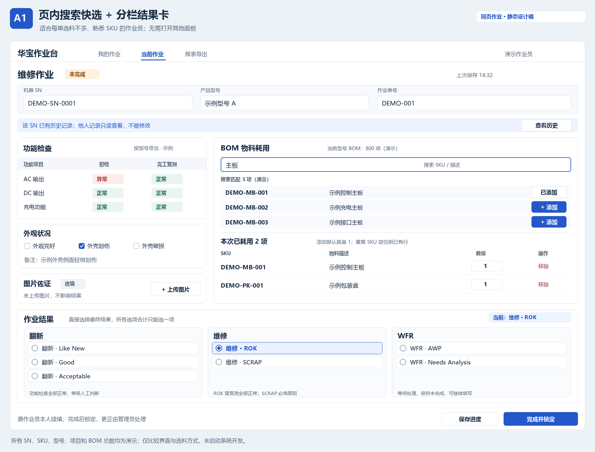
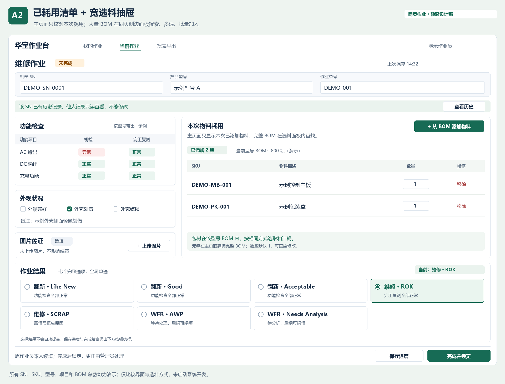
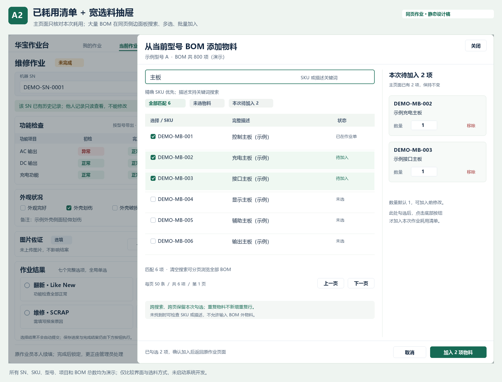

# 华宝翻新／维修系统：同页作业视觉与选料方案 v0.2

日期：2026-10-29  
状态：同页作业方向已确认；大量 BOM 录入方式与结果布局待选；仅文档与静态设计稿，未启动系统开发。

本稿补充并更新[需求大纲 v0.1](./华宝翻新维修记录系统_需求大纲_v0.1.md)第 11 节及第 13 节中的视觉选择状态。原稿保留作为访谈记录；其余已确认业务规则继续有效。本稿新提出的交互细节均为待本次评审的设计建议，不声称用户已逐项批准。

## 1. 最新确认与本次问题

已确认：选择同一页面完成作业录入，不采用原方案 B 的分步作业卡。

用户要求：

1. 型号 BOM 物料较多，需要明确可操作的选料、数量录入方案。
2. 原“先选翻新／维修／WFR、再在下方选结果”的上下层级不清晰，需要其他布局。
3. 基于同页作业再提供两版视觉方案；在方案确认前继续保持不开发。

静态图中的 800 项 BOM、SN、SKU、型号、描述、检查项目和数量全是演示，不能当作真实数据规模或真实业务资料。正式容量以实际型号 BOM 核对。

## 2. 两版共用的 BOM 设计原则（本次建议）

### 2.1 已确认的业务约束

- 只能选择当前型号 BOM 内的物料，包含 BOM 内包材，不新增包材分类或通用耗材入口。
- 每条物料包含 SKU、描述、实际使用数量；新选数量默认 1，可修改。
- 可选多项；不管理库存，不扣库存。
- 已选择的耗用关联当前作业单，不能因搜索或分页而丢失。

### 2.2 针对大量 BOM 的操作方案

1. 分开“BOM 候选物料”和“本次耗用清单”，主页面不堆放全部 BOM。
2. 搜索同时支持 SKU 和描述关键词，完整 SKU 精确匹配优先；SKU 不要求作业员完整背记，描述可部分输入。
3. 输入时显示匹配结果，每条同时显示 SKU 与描述，避免只凭相似名称选错料。
4. 初始不勾选任何物料；只有明确添加的物料进入本次耗用清单。
5. 一张作业单同一 BOM 物料只保留一行。重复添加时提示已添加并定位至已有行，不静默再增加一行或累加数量。需要多件时由作业员明确修改数量。
6. 数量可直接输入，默认 1；不自动拿 BOM 配套数量替代实际耗用数量。
7. 从本次清单移除即取消该物料耗用，不强迫用数量 0 保留无效行。
8. 切换搜索词、分页或滚动候选列表，不清空已加入物料及其数量。
9. SKU 与描述应可完整查看，长描述允许展开或换行，不能只看截断文本就要求选料。
10. 找不到物料时明确提示“当前型号 BOM 中未找到”，可清空筛选或改搜 SKU／描述；仍不能自由输入 BOM 外物料。真实缺项由管理员补正 BOM。
11. 搜索响应和长列表展示要适合实际最大 BOM；不要求把全部长列表同时显示或逐行滚动查找。
12. 已耗用项目很多时，清单内部可滚动并显示已选数量，保存／结案入口保持易于找到。

以上的查找与防重规则是本次方案建议。实际 BOM 如存在“同 SKU 多行但规格／版本不同”，必须先核对来源，不能仅凭相同 SKU 静默合并不同物料；界面应显示足以区分的原始描述。第一版不能编造未提供的版本或分类信息。

## 3. A1：页内搜索快选 + 分栏结果卡

### 3.1 选料流程

1. 在作业页物料区输入完整／部分 SKU 或描述关键词。
2. 页内直接展示匹配项；点“添加”立即进入下方本次耗用清单，数量默认 1。
3. 在本次耗用清单直接改数量；继续换关键词查找下一项。
4. 已有物料显示“已添加”，重复操作定位该物料行。
5. 匹配很多时只展示有限候选并允许查看更多／分页，不向作业员展开整个型号 BOM。

建议键盘支持：方向键选择候选，Enter 添加被明确选中的候选，Esc 关闭候选区。不能把“输入一个宽泛词后按 Enter”直接当作已确认选中第一条。

### 3.2 结果布局

翻新、维修、WFR 并排为三列，分类标题仅作说明，不再作为需要点击的一级菜单。七个最终结果始终可见，每项显示完整“类别 · 结果”，只需选一次。

- 翻新列：翻新 · Like New、翻新 · Good、翻新 · Acceptable。
- 维修列：维修 · ROK、维修 · SCRAP。
- WFR 列：WFR · AWP、WFR · Needs Analysis。

三列的单选控件属于同一组；不是三组各选一个。当前选项在顶部显示完整摘要。

### 3.3 优点与代价

优点：始终在原页面操作，逐项快速添加，不增加开关面板动作；类别分栏清晰。

代价：搜索候选和已选清单同时占用物料区空间；一次要找很多种物料或名称很长时，查找、逐条添加会较频繁。

## 4. A2：宽抽屉批量选料 + 单层完整结果卡

### 4.1 选料流程

1. 主页面只展示本次耗用清单，以及“从 BOM 添加物料”按钮。
2. 点击后在同一页面右侧打开宽选料面板，原作业页保留在背景，不跳转、不采用步骤页，尚未保存的其他录入内容保留。
3. 面板左侧是当前型号的 BOM 搜索及分页列表；每项完整显示 SKU、描述、选择状态。
4. 右侧是“本次待加入”清单，可在加入前填写数量、移除勾选。
5. 跨关键词、跨页保留待加入项；已有作业物料标识“已在作业单”，不重复加入。
6. 点击“加入 N 项物料”，一次加入作业页的本次耗用清单，然后关闭面板。
7. 点取消／关闭时，如有待加入内容，先确认是否放弃此次勾选；不擅自将候选加入，也不删除原页面已耗用物料。
8. 加入作业页只是更新当前表单；仍通过“保存进度”正式保存整张作业单，不把加入按钮误作已保存成功。

图中的每页 50 条是演示布局参数，实际每页条数在落地时根据真实数据及屏幕确定。

### 4.2 结果布局

七张完整结果卡直接排列为一组，每张都带“类别 · 结果”及简短条件，整张卡片可选择。不存在类别和子结果的上下层级。

选中态同时使用单选圆点、明显边框、文字及当前结果摘要，不能只用颜色变化提示。七张卡全局只能选择一张。

### 4.3 优点与代价

优点：长 BOM 有独立的大空间，适合看完整描述、跨搜索批量挑选；主页面只保留实际耗用，较清楚。

代价：需要打开面板、确认加入的动作；面板打开时会暂时遮住一部分检查和结果区域，但不离开同一作业页。

## 5. 结果选择的共用规则

1. 保留原访谈中翻新／维修／WFR 互斥的业务规则，只改呈现方式。
2. 点击一个完整结果，就可同时确定其类别和具体结果，无需先点类别。
3. 选择结果不等于结案；未满足检查等条件时仍可保存进度。
4. 翻新需功能项目全部正常；维修 ROK 需完工复测全部正常；SCRAP 需必填报废原因。
5. 选 SCRAP 后在结果区显著显示报废原因输入框，而不是把必填项藏在其他区。
6. WFR 的 AWP／Needs Analysis 保持未完成。选中 WFR 后，主操作应明确表示保存等待，不显示为“完成并锁定”以免误导结案。
7. 保存 WFR 后仍由原作业员续填；管理员更正和历史留痕规则继续有效。
8. 已确认的图片选填规则继续有效。
9. 默认不替作业员选择 ROK 或翻新等级。图中 ROK 是演示已选状态，真实新单结果初始为空。
10. Needs Analysis 为前一轮拼写校正后的推荐显示文案；内部业务代码的映射不在静态图中变更历史资料。

## 6. 推荐与可组合方案

鉴于用户明确指出 BOM 物料较多，优先推荐 A2 的宽选料面板：主页面保持本次耗用清晰，完整 BOM 使用独立空间搜索、分页、多选。

结果区可独立选择：

- 强调类别辨识：采用 A1 的三栏结果，标题明显、全部结果直接可选。
- 强调一次直接选择：采用 A2 的七张完整结果卡。

两者可以组合为“A2 选料 + A1 结果分栏”，不需要为了某个区域喜欢哪版而整版绑定选择。所选方案待用户评审，不自动成为开发授权。

## 7. 后续验收建议

- 用真实最大型号 BOM 验证能通过 SKU 和描述关键词找到目标，而不必遍历全部物料。
- 搜索和分页后，已耗用及待加入清单中的物料和数量不丢失。
- 同 SKU 重复点击不会产生重复耗用或静默多记数量。
- 长 SKU／描述有完整查看方式，不能因截断导致选错相似物料。
- 每次加入只影响明确选择的项目；取消面板不改变原作业耗用。
- 七个结果一次只能选一个，切换结果不会留下另一类别当前结果。
- WFR 不会被“完成并锁定”误结案；SCRAP 原因必填明确可见。
- 图中的中文、演示数字和模拟 SKU 不作为正式上线数据。

## 8. 下一步

用户选择整版 A1／A2，或分别选择选料方式与结果区布局，并提出视觉调整。确认后更新需求基线，仍不自动启动开发。
