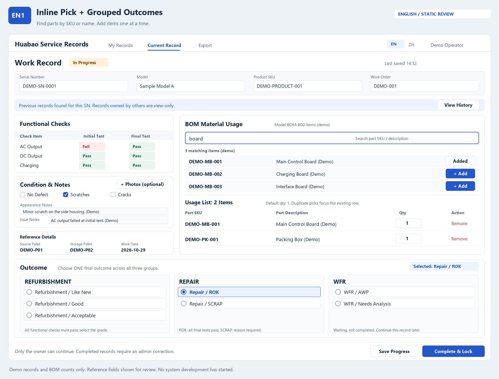
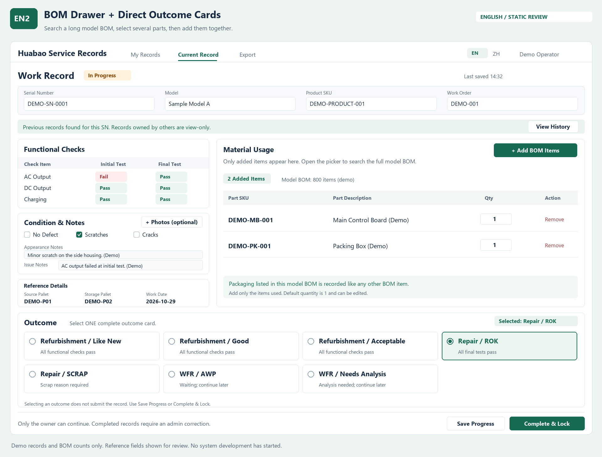

# 华宝翻新／维修记录系统：英文界面及现表字段映射 v0.3

日期：2026-10-29  
状态：英文版需求已确认；同页作业已确认；EN1／EN2 布局待选择；未启动系统开发。

本稿与[需求大纲 v0.1](./华宝翻新维修记录系统_需求大纲_v0.1.md)、[同页作业与 BOM 方案 v0.2](./同页作业_BOM与结果选择_方案v0.2.md)配合使用。最新访谈决定优先；本稿更新英文语言状态、补充现表核对证据和两版英文视觉，不改变之前已确认的业务规则。

## 1. 本轮新增确认与方案边界

用户明确提出：系统需要提供英文版，供外籍员工作业。英文界面属于第一版需求。

继续保持：电脑网页、同页作业、本人记录与同 SN 历史只读例外、管理员更正、按型号检查与 BOM、图片选填、WFR 续填、结案锁定及四张工作表导出。

本轮交付为静态设计与需求补充。不会因为提供英文视觉而自动创建应用、接口、数据库或部署环境，也没有修改飞书原表内容或配置。

## 2. 已读取的现表证据

### 2.1 来源与读取范围

用户本轮提供的[飞书共享视图](https://sagacitycn.feishu.cn/share/base/view/shrcn3Xyl3pVqwXcLVCMamAe0rg)。

2026-10-29：网页读取工具未成功，但通过浏览器成功打开共享视图；查看了表格左右侧及“字段配置”清单，未更改字段、记录、权限或选项。页面当时显示 196 条记录，这只是共享视图计数，不代表已逐条审计全部记录或所有关联表。

本轮成功读取的新分享视图，补足了 v0.1 中“现表未能读取”的证据缺口；v0.1 关于其当时读取失败的说明保留为历史，不再用来表示当前访问状态。

### 2.2 当前字段清单与映射建议

以下“原字段名”按页面字段清单保留，不静默改写原拼写。“英文建议／处理”用于新系统评审，不表示用户已批准新增全部旧字段功能。

| 原字段名 | 英文建议／处理 | 当前判断与待确认处 |
|---|---|---|
| SN | Serial Number | 对应已确认的 SN 录入和历史查询 |
| 原始照片 | Evidence Photos | 对应已确认的图片佐证；仍然选填 |
| 外观描述 | Appearance Notes | 保留原始文字描述，并与新预设缺陷多选共存 |
| 问题描述 | Issue Notes / Issue Description | 建议保留独立问题备注，不能全部替换为检查清单而丢失补充描述 |
| 外观描述-翻译 | Translated Appearance Notes | 说明现流程有翻译需求；不等于已授权自动翻译功能 |
| 问题描述-翻译 | Translated Issue Notes | 同上，原文与译文分开，不覆盖原文 |
| 机器挑货栈板编码 | Source Pallet | 作为同页参考信息的映射建议，准确业务定义待核对 |
| 存放栈板码 | Storage Pallet | 作为同页参考信息的映射建议，不新增库存移动或栈板管理流程 |
| 作业时间 | Work Date | 页面可见日期值；录入日期与系统创建／更新时间的关系需落地核对 |
| 翻新结果 | Outcome | 新系统按已确认的翻新／维修／WFR 全局互斥结果表达 |
| 机器产品简称 | Model / Product Name | 建议映射型号名称，正式型号表仍待提供核对 |
| SKU | Product SKU（暂定映射） | 所属实体和业务定义需核对，不能当作已证实的耗用零件 SKU |
| 入库SKU(1-like new 2-Good 3-accepteble) | Receiving SKU（暂定映射） | 原字段名含拼写差异；不擅自建立等级生成入库 SKU 的业务规则 |
| 产品名称校验（华宝） | Product Name Verification | 旧表校验信息，是否在第一版保留为参考待整体评审 |
| SKU校验（华宝确认） | SKU Verification | 同上，不自动增加华宝审批流程 |
| 分拣后SKU | Post-Sort SKU | 与耗用 Part SKU 分开；映射、生成规则未确认 |
| 入库单号 | Receiving Order No. | 不因此扩大到仓库入库系统或自动创建入库单 |
| 入库单状态 | Receiving Status | 如需保留可作为参考，第一版尚未确认系统对接 |
| SN重复判断 | SN History / Duplicate Indicator | 新系统已有 SN 历史提示；重复 SN 本身不禁止独立返修建单 |
| 父记录 | Parent Record | 来源关系字段；不自行推断其关联业务或迁移结构 |
| 文本 9 | Unspecified Text Field | 含义未定义，不能随意重命名为某个业务字段 |

### 2.3 从现表观察到、需要避免的问题

- 原视图存在翻译栏，部分可见单元格显示“空内容，无输出”等提示类文本。新系统不应把此类内容当作有效外观或问题描述；原文为空时译文保持为空。
- 现表含多个不同 SKU 字段，因此新设计区分顶部整机参考信息与物料区的 **Part SKU**。顶部 **Product SKU** 目前是映射建议，不能据此宣称原表 SKU 已被正式定义。
- 现表同时有文字问题描述和结果。结构化检查结果不能替代所有问题备注，也不能把旧表等待类标签未经核对就批量转换为新 WFR 原因。
- 未逐条核实所有历史结果值、公式、关联关系和校验逻辑；未执行导出、迁移或自动清洗。

## 3. 英文版覆盖范围

### 3.1 已确认目标

外籍作业员能通过英文完成记录、查找物料、填写耗用、上传图片、保存进度及提交结果，无需依赖中文界面完成核心流程。

### 3.2 为满足目标提出的设计要求（本稿整体评审）

- 页面标题、导航、字段标签、按钮、提示、必填说明、错误、确认、空状态、上传反馈和历史只读提示均有英文。
- 功能检查项目和外观缺陷选项提供经业务确认的英文名称，不只翻译栏目标题。
- 型号显示名称和 BOM 描述需有外籍员工可识别的名称。Part SKU 本身保持原编码，不作翻译或改写。
- 新单结果初始为空，不预选 ROK；图中的 ROK 是演示状态。
- WFR 选择后的主操作显示为 **Save WFR** 或明确等价文案，保持未完成；不误导为 Complete & Lock。
- 管理员更正原因、报废原因、自由备注允许直接输入英文；不强制先写中文再翻译。
- 中英文显示使用同一条作业数据；切换界面语言不清空未保存输入、不重建检查、不重置物料数量、不改变业务结果。

### 3.3 中英文切换为建议，不冒充新增已确认决定

用户明确要求有英文版；本稿建议保留中文并提供 EN／ZH 选择，便于中方管理员与外籍作业员分别使用。图中的 EN／ZH 是这一设计建议。

建议各账号可记住语言偏好，外籍作业员使用英文。是否所有账号默认英文、报表是否需英文／双语表头，尚未单独指定，可随整体方案评审；不能仅因界面是英文就将历史中文记录替换为英文。

## 4. 英文文案表

| 中文 | 英文显示 |
|---|---|
| 我的作业 | My Records |
| 当前作业 | Current Record |
| 作业记录 | Work Record |
| 作业单号 | Work Order |
| 机器 SN | Serial Number |
| 型号 | Model |
| 物料 SKU | Part SKU |
| 物料描述 | Part Description |
| 实际耗用数量 | Qty / Quantity Used |
| 初检 | Initial Test |
| 完工复测 | Final Test |
| 功能检查 | Functional Checks |
| 正常 | Pass |
| 异常 | Fail |
| 未检查 | Not Tested |
| 外观描述／备注 | Appearance Notes |
| 问题描述／备注 | Issue Notes |
| 外观完好 | No Defect |
| 图片佐证 | Evidence Photos |
| 选填 | Optional |
| 保存进度 | Save Progress |
| 完成并锁定 | Complete & Lock |
| 未完成 | In Progress |
| 已完成 | Completed |
| 查看历史 | View History |
| 只读 | View-only |
| 作业结果 | Outcome |
| 翻新 | Refurbishment |
| 维修 | Repair |
| 导出 | Export |

结果英文保留 **Like New / Good / Acceptable / ROK / SCRAP / AWP / Needs Analysis**。WFR 与 AWP 保留代码，未核实的缩写不擅自展开。

补充提示建议：

- `Previous records found for this SN. Records owned by others are view-only.`
- `No matching items in this model BOM. Check the part SKU or try another word.`
- `This item is already on the usage list. Update its quantity in the existing row.`
- `Complete all final tests with a Pass result before selecting ROK for completion.`
- `Enter a scrap reason before completing this record.`
- `Upload failed. Your photo has not been saved. Please try again.`

具体英文技术项目需由实际型号功能清单核对，图中 AC Output、DC Output、Charging 均为示例，不等于最终检查清单。

## 5. BOM 和文字内容的翻译边界

1. SKU 保持原值；型号和物料描述可维护原文与英文展示名称。
2. BOM 英文名称应由管理员或业务负责人提供／确认；相似部件、版本、接口、规格等区分信息必须保留。
3. 不能把样例英文描述冒充实际 BOM 翻译，不能依据一张静态图声称全部物料已译好。
4. 英文缺失时不可无提示地显示为空、显示“翻译中”却允许当作正式名称，或编造译名。上线前应核对启用型号、功能项目、外观字典及 BOM 的英文覆盖。
5. 自由文本保留作业员输入的原文。自动翻译、双向翻译、调用外部翻译服务未被本轮授权开发，不预设为已确认功能。
6. 英文缺失的临时处理方式和原文查看入口可在开发设计中提出，但不能以临时回退替代外籍员工所需的正式可读信息。
7. 如日后迁移旧表，保留原字段名、原值、原文和明确的映射，不直接纠正来源拼写或用占位翻译填充历史事实。

## 6. 两版英文视觉

两版均为同一页面作业，照片选填、BOM 耗用、结果单选等规则一致。新增的 Product SKU 与 Reference Details 属于根据现表提出的映射建议，是否完整继承这些参考栏位仍待用户整体评审，不意味着新增仓库系统。

### EN1：Inline Pick + Grouped Outcomes

- 页内按 Part SKU 或英文描述查找，逐项添加，数量在本次耗用清单中修改。
- 结果分 Refurbishment／Repair／WFR 三栏，七项全部可见，属于一组单选。
- 适合每单物料种类较少、希望尽量不打开其他面板的操作。
- 代价：候选物料和已耗用列表共同占用主页面空间。

### EN2：BOM Drawer + Direct Outcome Cards

- 主页面只显示本次物料耗用，宽选料面板支持英文搜索、多选、填写数量、批量加入。
- 七张完整结果卡全局单选，每张显示类别及具体结果。
- 适合型号 BOM 较长或一次需要挑选多个物料的操作。
- 代价：多一个打开和确认面板动作；面板打开时暂时遮住部分主页面，但不跳转或清空原表单。

建议优先采用 EN2 的选料方式；结果区可以独立组合 EN1 三栏布局。两版不是绑定整套选择。

## 7. 英文使用的验收建议

- 使用英文账号完成新建、检查、选料、改数量、备注、照片、WFR 保存、续填和最终结案，全流程不存在阻断操作的中文必填提示。
- 英文搜索能找到正确 BOM 物料，SKU 和规格不因翻译改变。
- 同一 SKU 重复选择不重复记耗；跨搜索、跨页保留已选项和数量。
- 切换语言不会改变 Pass／Fail／Not Tested、翻新等级、维修结果、WFR 原因或历史记录。
- 关键英文长标签可完整阅读，例如 Refurbishment / Acceptable、WFR / Needs Analysis，不覆盖按钮和输入框。
- 未测项不会因翻译变成 Pass；WFR 不会因显示英文而变成已完成。
- 英文自由备注和中文历史原文均可保存、查看和完整导出，不用翻译覆盖原文。
- 原表仓库、华宝校验、关联字段不会因视觉映射而触发未经确认的入库或审批流程。

## 8. 下一步

用户评审 EN1／EN2 或组合方案，并确认是否保留图中的现表参考信息。英文需求已经记录，不再要求用户重复确认“是否需要英文”。方案选择及文档确认不自动启动开发。
